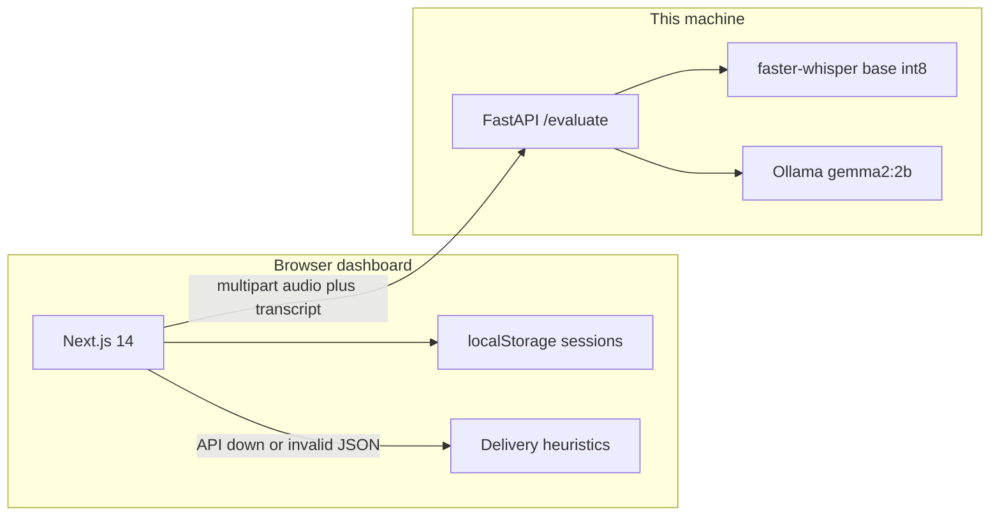
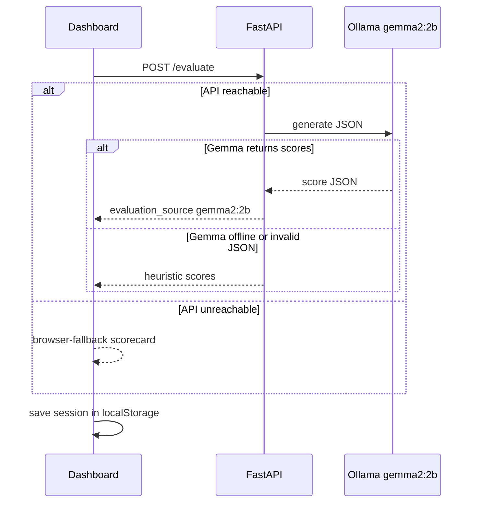

# EchoHire

EchoHire is a privacy-first interview coach. You pick a role, answer out loud, and get a scorecard for clarity, confidence, and STAR structure. Speech-to-text and scoring run on your machine with open-weight models. If the local server is down, the browser still returns a full score from the same delivery heuristics, so a demo does not go blank.

This project was built for the [Hacktoberfest 2026 Week 3](https://dev.to/events/81) challenge, **Slow and Steady**: open-source AI that does the tedious work and lets you move at your own pace. The theme fits a practice tool that listens once, scores the answer, and tells you the three smallest edits that would help.

## Why local open-source AI

A closed interview coach sends your voice to someone else's API and bills every minute. EchoHire does the opposite.

- **The recording stays here.** `faster-whisper` transcribes audio in the FastAPI process. Gemma 2B (`gemma2:2b`) scores the transcript through Ollama on `localhost`. Nothing in the happy path is a cloud speech or chat API.
- **The cost stays at $0.** Open weights have no per-request fee. Practicing ten answers costs the same as practicing one.
- **You can swap the model.** Ollama is just an HTTP server. The scorer is `gemma2:2b` because it is small enough to run on a CPU and still return JSON. Point the same API at another open model if you want.
- **A judge can still use it.** The Next.js app saves nothing to a vendor account. If `http://localhost:8000` is unreachable, the dashboard scores the transcript in the browser and says so on the scorecard.

Open weights matter here because the product is the candidate's voice. Keeping that audio off a third-party server is the feature, not a deployment detail.

## Architecture



1. The dashboard records `audio/webm` and a live transcript.
2. `POST /evaluate` sends the role, mode, question, transcript, duration, and optional audio.
3. If the transcript is empty and audio is present, the API transcribes it with `WhisperModel("base", device="cpu", compute_type="int8")`.
4. Delivery stats are deterministic: word count, words per minute, filler counts, and STAR keyword hits.
5. Gemma is asked for strict JSON: four scores from 1 to 10, three strengths, three lazy fixes, and a rewritten STAR answer.
6. If Ollama is offline, times out, or returns junk, the API fills those same fields from the heuristics. If FastAPI itself is down, the browser does that job and flags `mode: "browser-fallback"`.



## Lazy payoff

The slow part of interview prep is replaying yourself and noticing the missing STAR beat. EchoHire does that pass for you:

- A **Load Sample Candidate Response** button runs the whole pipeline without a microphone, which is the path for a reviewer who cannot speak into the demo.
- The scorecard's **3 Lazy Fixes** are one-line edits, not a rewrite of your career.
- History keeps finished scorecards in `localStorage`, so you can reopen a session without running the model again.

## Project layout

| Path | What it is |
| --- | --- |
| `backend/main.py` | FastAPI app: `/health`, `/evaluate`, Whisper, Ollama, heuristic fallback |
| `backend/requirements.txt` | Python dependencies for a local machine, including faster-whisper |
| `backend/requirements-render.txt` | Slim Python dependencies for the Render image (no Whisper wheel) |
| `backend/Dockerfile` | Render image: Python plus Ollama |
| `backend/start.sh` | Starts Ollama, pulls `gemma2:2b` onto the disk, then uvicorn on `$PORT` |
| `render.yaml` | Render Blueprint: free dashboard and free API |
| `frontend/src/app/page.tsx` | Dark dashboard: status, history, role, studio, scorecard |
| `frontend/src/components/RoleSelector.tsx` | Four roles, behavioral/technical toggle, privacy banner |
| `frontend/src/components/InterviewStudio.tsx` | Question, read-aloud, recording, live WPM and STAR |
| `frontend/src/components/ScorecardView.tsx` | Gauges, telemetry, feedback, Markdown and JSON export |
| `frontend/src/lib/api.ts` | Types, question bank, health check, evaluate, browser fallback |

## Setup

You need Python 3.10+, Node.js 18+, [Ollama](https://ollama.com), and [ffmpeg](https://ffmpeg.org) on `PATH` so browser WebM can be decoded.

### 1. Gemma 2B

```bash
ollama pull gemma2:2b
ollama serve
```

`ollama serve` listens on `http://localhost:11434`. Leave that process running.

### 2. Backend

```bash
cd backend
python -m venv .venv
```

Windows:

```powershell
.venv\Scripts\activate
pip install -r requirements.txt
python main.py
```

macOS and Linux:

```bash
source .venv/bin/activate
pip install -r requirements.txt
python main.py
```

The API listens on `http://localhost:8000`.

- `GET /health` checks Ollama's `/api/tags` and whether `faster-whisper` imports.
- `POST /evaluate` accepts form fields `role`, `mode`, `question`, `transcript`, `duration_seconds`, and an optional `audio` file.

The first transcription downloads the Whisper `base` weights. Later takes reuse the loaded model.

### 3. Frontend

```bash
cd frontend
npm install
npm run dev
```

Open `http://localhost:3000`. The navbar pill should read **FastAPI + Ollama** when both the API and `gemma2:2b`'s host are up. The pill opens a field if the API is not on port 8000. That URL is stored in `localStorage` under `echohire.backendUrl`.

## Using the dashboard

1. Choose a role and Behavioral or Technical. Each built-in role starts with three questions in each mode. Use **Add a question** to save more in this browser.
2. Press **Read Aloud** to hear the question, then **Record**, or press **Load Sample Candidate Response**.
3. Watch words per minute, filler counts, and the STAR badges update as the transcript changes.
4. Press **Evaluate with Local Open-Source AI (Gemma 2B + Whisper)**.
5. Read the scorecard. Copy the Markdown report or download the JSON telemetry.
6. Open **History** to reopen any saved session. Sessions live in `localStorage` under `echohire.sessions` (the newest 30).

WPM colors: amber under 100, emerald from 110 to 160, rose over 170.

## When something is offline

| What is down | What you still get |
| --- | --- |
| Groq key missing or Groq errors | FastAPI tries local Gemma, then the delivery heuristics. |
| Ollama or `gemma2:2b` | FastAPI returns heuristic scores when Groq is also unavailable. The UI stays up. |
| FastAPI | The browser scores the transcript and labels the scorecard as a browser fallback. |
| Microphone or speech recognition | Type the answer, or load the sample. |

The health pill reads **FastAPI + Groq** when `GROQ_API_KEY` is accepted, **FastAPI + Ollama** when `gemma2:2b` is installed, **API up · model offline** when the API is up and neither scorer is ready, and **Backend offline** when FastAPI cannot be reached.

Put the key from [Groq API keys](https://console.groq.com/keys) in `backend/.env`:

```
GROQ_API_KEY=your-key-here
```

That file is gitignored. The hosted model is `openai/gpt-oss-20b`. The recording stays in the browser. Groq receives the transcript text.

## Deploy on Render

Both services use Render's **$0 free plan** (512 MB). Free instances sleep after about 15 minutes without traffic, and the first open after sleep can take a minute. Whisper and Gemma stay off this image. The browser still fills the transcript. The hosted API scores with Groq, then the heuristic scorecard. Gemma still scores on a laptop where `gemma2:2b` is installed.

| Service | Plan | What it runs |
| --- | --- | --- |
| `echohire-web` | Free, 512 MB | Next.js on `$PORT` |
| `echohire-api` | Free, 512 MB | FastAPI on `$PORT`, scoring through Groq |

The web service reads `NEXT_PUBLIC_API_URL` from the API service's public URL at build time. Locally, with that variable unset, the dashboard still calls `http://127.0.0.1:8000`.

1. Push this repo to GitHub.
2. In the Render dashboard, choose **New** → **Blueprint** and select the repo. Render reads `render.yaml` from the root. Both plans must say **Free**.
3. Apply the blueprint. The first web build can start before the API URL exists. If the live dashboard still points at `127.0.0.1`, open `echohire-web`, set `NEXT_PUBLIC_API_URL` to the API URL (it looks like `https://echohire-api.onrender.com`), and trigger a manual deploy of the web service.
4. When Render asks for `GROQ_API_KEY`, paste the same key that is in `backend/.env`. The key is stored on the service, not in git. Without it, Evaluate still returns the heuristic scorecard.
5. Open the web service URL. After the free instance wakes, the pill reads **FastAPI + Groq**.

## Hacktoberfest 2026 Week 3

Week 3 asks for something built with open-weight or open-source AI that rewards laziness: the tool should do a task you would otherwise grind through. EchoHire's open pieces are the product:

- Local inference with **Gemma 2B**, a featured category in the challenge.
- Local speech with **faster-whisper**, so practice audio is not a SaaS upload.
- A fallback path so the demo still finishes when a reviewer does not have Ollama running.
- A public scoring API on **Render's free plan**. Groq scores there. Gemma 2B still runs on a machine that has the model installed.

The challenge write-up belongs on DEV with the tag `#hf26challenge`. Details and the submission window are on the [Week 3 event](https://dev.to/events/81) and the [HF26 hub](https://dev.to/challenges/hf26). The event text says submissions are due October 25, 2026 at 11:59 PM PDT.
